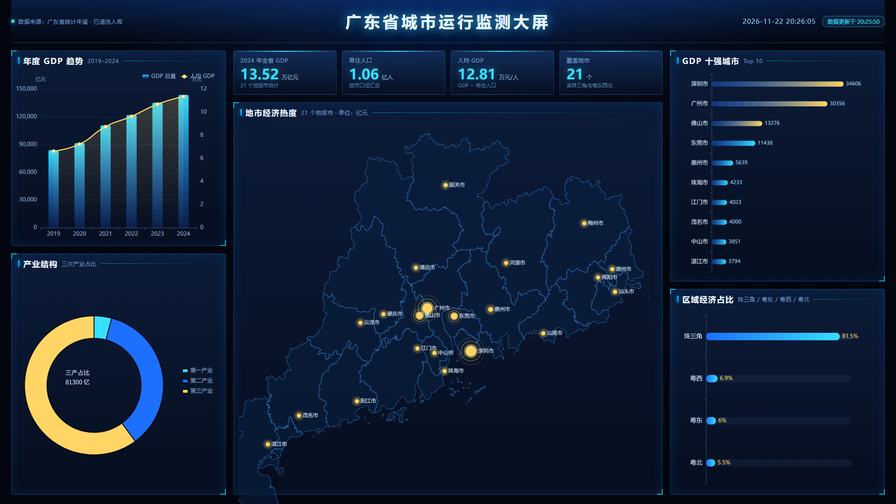

# 广东省城市运行监测系统

<p>
  
  
  
  
  
  
</p>

**Vue 3 + Vite + ECharts 5 + Flask + Pandas** ｜ 21 个地级市 × 72 个月的指标看板

> ### [🌐 在线演示](https://jc67486.github.io/gz-city-dashboard/)
> 数据经 Pandas 清洗入库后由 Flask 提供接口，前端渲染 6 类图表；线上版本使用构建期导出的静态快照。



<p align="center">
  <sub>1920×1080 主视图 · KPI + 折线柱状混合图 + 地图散点 + Top10 排行 + 区域占比，共 6 类图表</sub>
</p>

## 功能模块

| 模块 | 说明 |
|---|---|
| 数据层 | 从原始 Excel 清洗出 7560 行月度明细，落库并建复合索引 |
| 接口层 | 6 个 REST 接口，统一 `{code, data, msg}`，高频接口 60s 内存缓存 |
| 展示层 | 6 类 ECharts 图表 + 广东 GeoJSON 地图散点，1920×1080 设计稿等比缩放 |
| 降级 | 接口失败保留上次数据并置灰提示；页面不可见时暂停轮询 |
| 分析 | CR4 / HHI / 变异系数 / 位序-规模回归，输出 5 页报告 |

## 技术栈

| 层 | 技术 |
|---|---|
| 前端 | Vue 3（组合式 API）、Vite 5、ECharts 5（按需引入）、Axios |
| 后端 | Flask 3、SQLite（可切 MySQL）、Gunicorn 部署 |
| 数据 | Pandas / NumPy 清洗、SQLAlchemy 分批写入 |

## 快速开始

### 方式一：只看前端（无需后端）

线上版本用的是构建期导出的静态数据，本地也能以同样方式跑：

```bash
npm install
npm run build
npx vite preview        # http://localhost:4173/gz-city-dashboard/
```

### 方式二：完整跑通（含清洗 + 接口）

```bash
# 1. 后端
cd server
pip install -r requirements.txt
python seed.py          # 生成脏数据 → 清洗 → 入库，打印校验日志
python app.py           # http://127.0.0.1:5001

# 2. 前端（另开一个终端）
cd ..
npm install
npm run dev             # http://127.0.0.1:5173（自动代理 /api）
```

## 接口

| 接口 | 说明 |
|---|---|
| `GET /api/overview` | 顶部 KPI（GDP / 人口 / 人均 / 地市数） |
| `GET /api/trend?range=6` | 年度趋势 |
| `GET /api/region-share` | 珠三角 / 粤东 / 粤西 / 粤北 占比 |
| `GET /api/city-rank?top=10` | GDP 排行 |
| `GET /api/city-map` | 城市坐标 + 指标（地图散点） |
| `GET /api/industry` | 三次产业占比 |

统一响应结构 `{ code, data, msg }`，参数校验失败返回 `400`，接口不存在返回 `404`。

## 数据清洗做了什么

原始数据被刻意做脏，模拟真实年鉴导出的常见问题：

| 问题 | 处理方式 | 影响行数 |
|---|---|---|
| 表头错位 / 中英混排字段 | rename 统一为英文列名 | 全表 |
| 单位混用（万元 / 亿元） | 按量级判断后统一为亿元 | 修正 4 行 |
| 人口字段缺失 | 按中位数填充（仅非核心城市注入缺失，避免人均指标失真） | 3 处 |
| 异常值 | 城市 GDP 为右偏分布，IQR 会把广深佛莞误判为异常，改用业务区间 `[100, 50000]` 亿元校验 | 0 行误杀 |
| 明细重复行 | 按 `(城市, 月份, 指标)` 去重 | 7770 → 7560 行 |
| 查询慢 | 建 `(city_name, month)`、`(indicator, year)` 复合索引 | EXPLAIN 命中 |

## 数据分析

```bash
cd server
python analyze.py       # CR4 / HHI / 变异系数 / 位序-规模回归，输出 4 张图与 metrics.json
python build_report.py  # 生成《广东省 21 市经济结构对比分析》（5 页 DOCX）
```

主要结论（完整报告见 `server/广东省21市经济结构对比分析.pdf`）：

- **区域失衡**：珠三角 9 市占全省 GDP **81.5%**，人均 13.79 万元，是粤东西北（5.19 万）的 **2.7 倍**；CR2 48.0%、CR4 66.3%、HHI 1410
- **人均差距**：极差 **5.4 倍**（深圳 19.45 万 vs 梅州 3.63 万），变异系数 54.2%，中位数 6.08 万低于均值 7.91 万（右偏）
- **城市体系**：位序—规模回归斜率 **-1.21**、R² 0.969，接近 Zipf 分布；斜率绝对值 > 1 说明首位城市偏大、虹吸强于扩散

## 测试

```bash
cd server
python -m pytest tests -q --cov=app --cov-report=term-missing
# 13 passed，app.py 覆盖率 97%
```

覆盖点：接口返回结构、`range`/`top` 参数边界、60s 缓存命中、区域占比合计 100%、城市坐标落在广东经纬度范围、三次产业合计≈全省 GDP、404。

## 性能数据

| 指标 | 数值 | 测量方式 |
|---|---|---|
| 接口响应 | 平均 45 ms（冷启动 181 ms） | 6 个接口逐个计时，含 60s 缓存命中 |
| 构建产物 | 826 KB / 626 模块 | `npm run build` 输出 + `dist` 目录汇总 |
| ECharts 分包 | gzip 后 210.8 KB | 构建输出 |
| 数据量 | 21 市 + 7560 行明细 + 6 年趋势 | `python seed.py` 日志 |
| 测试覆盖率 | 97% | `pytest --cov=app` |

## 踩坑记录

1. **ECharts 地图散点不渲染**：`effectScatter` 在 `geo` 坐标系下 `value` 必须是 `[lng, lat, 数值]`，传 `{coord, value}` 不显示。
2. **缩放后文字模糊**：`transform: scale` 只缩放 CSS 尺寸，canvas 仍按 CSS 像素绘制，需用 `devicePixelRatio × 2` 初始化实例再 `resize()`。
3. **子路径部署后地图空白**：`fetch('/guangdong.json')` 硬编码根路径，GitHub Pages 部署在 `/仓库名/` 下会 404，必须用 `import.meta.env.BASE_URL` 拼接。
4. **dev server 被外部进程拖死**：把浏览器 `user-data-dir` 放进项目目录后，Vite 的 watcher 会去 watch 浏览器缓存文件并报 `EBUSY`，需在 `server.watch.ignored` 里排除。
5. **异常值检测误杀头部城市**：右偏分布下 3σ / IQR 会把广深佛莞判成异常直接抹掉，改用业务区间校验。

## 目录结构

```
big-screen/
├── server/
│   ├── seed.py             # 生成脏数据 → Pandas 清洗 → 入库 + 建索引
│   ├── app.py              # Flask 接口（统一 code/data/msg，60s 内存缓存）
│   ├── export_static.py    # 导出静态快照（供 GitHub Pages 部署）
│   ├── analyze.py          # CR4 / HHI / CV / Zipf 计算 + 4 张图
│   ├── build_report.py     # 生成分析报告 DOCX
│   ├── tests/              # pytest（13 个用例，覆盖率 97%）
│   └── data/               # 原始表 / 明细 CSV / SQLite（不入库，seed.py 可重建）
├── src/
│   ├── api/index.js        # Axios 封装 + 错误码映射 + 静态模式切换
│   ├── hooks/useChart.js   # 图表实例统一管理（创建 / resize / 销毁）
│   ├── components/PanelBox.vue
│   └── App.vue             # 1920×1080 设计稿 + transform: scale 自适应
├── public/
│   ├── guangdong.json      # 广东 GeoJSON
│   └── mock/               # 静态数据快照
└── .github/workflows/      # push 自动部署 GitHub Pages
```
